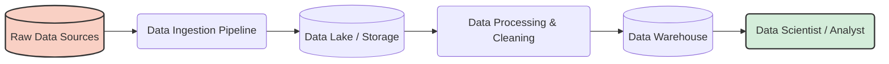

# Section 1: Introduction to Data Engineering & The Cloud

Welcome to the first section of the **Introduction to Data Engineering** course! We will explain everything in simple, easy-to-understand English. 

## 1. Introduction to Data Engineering

### What is Data Engineering? (Data Engineering Defined)
Imagine you have a giant water reservoir (data source), but people in a city need clean drinking water in their homes (data consumers). A **Data Engineer** is like the plumber who builds the pipes, filters the water, and makes sure it flows safely and quickly to the city. 

In technical terms, **Data Engineering is the practice of designing, building, and maintaining systems that take raw data and turn it into high-quality, usable data for analysis and machine learning.**

### A Brief History of Data Engineering
- **1980s - 2000s:** We used Traditional Databases (SQL) and Data Warehouses. It was slow, and storing data was very expensive.
- **2000s - 2010s:** Big Data arrived! Technologies like **Hadoop** and **MapReduce** were invented to process massive amounts of data across many computers at once.
- **2010s - Present:** The Cloud Era! We now use cloud services like **AWS**, Google Cloud, and Snowflake, making data processing extremely fast, scalable, and easy to manage.

### The Data Engineer Among Other Stakeholders
You do not work alone. You work with a team:
- **Data Analyst:** Uses your clean data to create dashboards (like Tableau or PowerBI) and reports.
- **Data Scientist:** Uses your data to find complex patterns and build AI models.
- **Machine Learning (ML) Engineer:** Puts the Data Scientist's AI models into production apps.
- **Software Engineer:** Builds the apps (like an e-commerce website) that generate the raw data in the first place.
- **Business Stakeholders:** Managers and CEOs who need data to make important business decisions.

### Business Value
Why do companies hire Data Engineers? Because without clean and organized data, Data Scientists cannot build AI, and Managers cannot make good decisions. "Garbage In, Garbage Out" (GIGO). **You are the foundation of all AI and Analytics!**

### System Requirements & Gathering
Before building a data pipeline, you must ask stakeholders the right questions:
- *How much data is coming? (Volume)*
- *How fast does it arrive? (Velocity)*
- *What type of data is it? (Variety)*
- *Who needs this data and how often?*

**Translating Stakeholder Needs:** 
If a marketing manager says, *"I want to see live sales on my screen every minute,"* you must translate this into a technical requirement: *"We need to build a real-time streaming data pipeline using Apache Kafka or AWS Kinesis."*

---

## 2. Data Engineering On the Cloud

### Why the Cloud?
In the past, companies bought expensive servers (computers) and kept them in a cold room in their building (On-Premise). Today, we rent computers from companies like Amazon (AWS), Google (GCP), or Microsoft (Azure). This is "The Cloud." It is cheaper, faster, and you only pay for exactly what you use.

### Intro to AWS Core Services
AWS (Amazon Web Services) is the most popular cloud provider. Let's learn its core services for Data Engineering:

#### 1. Compute - Amazon EC2 (Elastic Compute Cloud)
EC2 is simply a **virtual computer in the cloud**. You can rent a tiny computer to test a script, or a massive supercomputer to process terabytes of data. You can turn it on or off with a simple click.

#### 2. Networking - VPC (Virtual Private Cloud) & Subnets
A VPC is your **private, secure network in the cloud**. It's like building a virtual fence around your EC2 computers so hackers from the internet cannot reach them. 
- **Subnets** are smaller sections inside your VPC.
- **Public Subnet:** Connected to the internet (e.g., a web server).
- **Private Subnet:** Hidden from the internet (e.g., your secure databases).

#### 3. Security - AWS Shared Responsibility Model
Security in the cloud is a partnership. 
- **AWS is responsible for security OF the cloud:** They protect the physical buildings, servers, and cables.
- **You are responsible for security IN the cloud:** You must use strong passwords, open the correct network ports, and encrypt your sensitive data.

*(Visualizing the AWS Shared Responsibility Model)*

### Creating an AWS Account & Management Console
To start your practical journey, you will need to create a **Free Tier AWS account**. The **AWS Management Console** is the website where you click buttons to create EC2 servers, manage your VPC, and check your billing. It is your control center for everything in the cloud!
