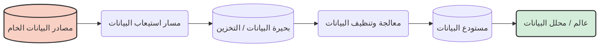

# القسم 1: مقدمة في هندسة البيانات والسحابة

مرحبًا بك في القسم الأول! سنشرح كل شيء بلغة بسيطة وسهلة الفهم.

## 1. مقدمة في هندسة البيانات

### ما هي هندسة البيانات؟
تخيل أن لديك خزان مياه ضخم (مصدر بيانات)، لكن سكان المدينة يحتاجون إلى مياه شرب نظيفة في منازلهم (مستهلكو البيانات). **مهندس البيانات** يشبه السباك الذي يبني الأنابيب، ويصفي المياه، ويتأكد من تدفقها بأمان وسرعة إلى المدينة.

بالمصطلحات التقنية، **هندسة البيانات هي ممارسة تصميم وبناء وصيانة الأنظمة التي تأخذ البيانات الخام وتحولها إلى بيانات عالية الجودة وقابلة للاستخدام في التحليل والتعلم الآلي.**

### تاريخ موجز لهندسة البيانات
- **1980s - 2000s:** قواعد البيانات التقليدية ومستودعات البيانات.
- **2000s - 2010s:** وصول البيانات الضخمة (Big Data)! تم اختراع Hadoop و MapReduce.
- **2010s - الحاضر:** عصر السحابة (Cloud Era)! نستخدم AWS و Google Cloud.

### مهندس البيانات بين أصحاب المصلحة الآخرين
- **محلل البيانات:** يستخدم البيانات لإنشاء لوحات المعلومات (Dashboards).
- **عالم البيانات:** يبني نماذج الذكاء الاصطناعي.
- **مهندس تعلم الآلة:** يضع نماذج الذكاء الاصطناعي في الإنتاج.
- **مهندس البرمجيات:** يبني التطبيقات التي تولد البيانات.

### متطلبات النظام
قبل بناء مسار بيانات، يجب أن تسأل:
- كم حجم البيانات؟ (الحجم - Volume)
- ما سرعة وصولها؟ (السرعة - Velocity)
- ما نوع البيانات؟ (التنوع - Variety)

---

## 2. هندسة البيانات على السحابة

### لماذا السحابة؟
اليوم، نستأجر أجهزة كمبيوتر من شركات مثل Amazon (AWS). هذا أرخص وأسرع وتدفع فقط مقابل ما تستخدمه.

### مقدمة عن خدمات AWS
#### 1. الحوسبة - Amazon EC2
EC2 هو ببساطة **جهاز كمبيوتر افتراضي في السحابة**.
#### 2. الشبكات - VPC
VPC هي **شبكتك الخاصة والآمنة في السحابة**.
#### 3. الأمان - نموذج المسؤولية المشتركة
- **AWS مسؤولة عن أمان السحابة (المباني والخوادم).**
- **أنت مسؤول عن الأمان داخل السحابة (كلمات المرور وتشفير البيانات).**
