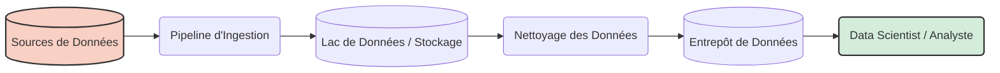

# Section 1 : Introduction à l'Ingénierie des Données et au Cloud

Bienvenue dans la première section ! Nous allons tout expliquer dans un langage simple.

## 1. Introduction à l'Ingénierie des Données

### Qu'est-ce que l'Ingénierie des Données ?
Imaginez que vous avez un immense réservoir d'eau (source de données), mais que les habitants d'une ville ont besoin d'eau potable (consommateurs). L'**Ingénieur Data** est comme le plombier qui construit les tuyaux, filtre l'eau et s'assure qu'elle coule rapidement.

En termes techniques, **l'Ingénierie des Données est la pratique consistant à concevoir, construire et maintenir des systèmes qui prennent des données brutes et les transforment en données de haute qualité.**

### Un Bref Historique
- **1980s - 2000s :** Bases de données traditionnelles (Lent et cher).
- **2000s - 2010s :** Le Big Data ! Hadoop et MapReduce.
- **2010s - Présent :** L'ère du Cloud ! AWS, Google Cloud, Snowflake.

### L'Ingénieur Data et son équipe
- **Data Analyst :** Crée des tableaux de bord (Dashboards).
- **Data Scientist :** Construit des modèles d'IA.
- **Ingénieur Machine Learning :** Met les modèles d'IA en production.
- **Ingénieur Logiciel :** Construit les applications.

### Exigences du Système
Avant de construire un pipeline, demandez :
- Volume (Quelle quantité ?)
- Vélocité (À quelle vitesse ?)
- Variété (Quel type ?)

---

## 2. L'Ingénierie des Données sur le Cloud

### Pourquoi le Cloud ?
Aujourd'hui, nous louons des ordinateurs à des entreprises comme Amazon (AWS). C'est moins cher et plus rapide.

### Introduction aux services AWS
#### 1. Calcul - Amazon EC2
Un ordinateur virtuel dans le cloud.
#### 2. Réseau - VPC
Votre réseau privé et sécurisé dans le cloud.
#### 3. Sécurité - Modèle de Responsabilité Partagée
- **AWS gère la sécurité DU cloud.**
- **Vous gérez la sécurité DANS le cloud.**
